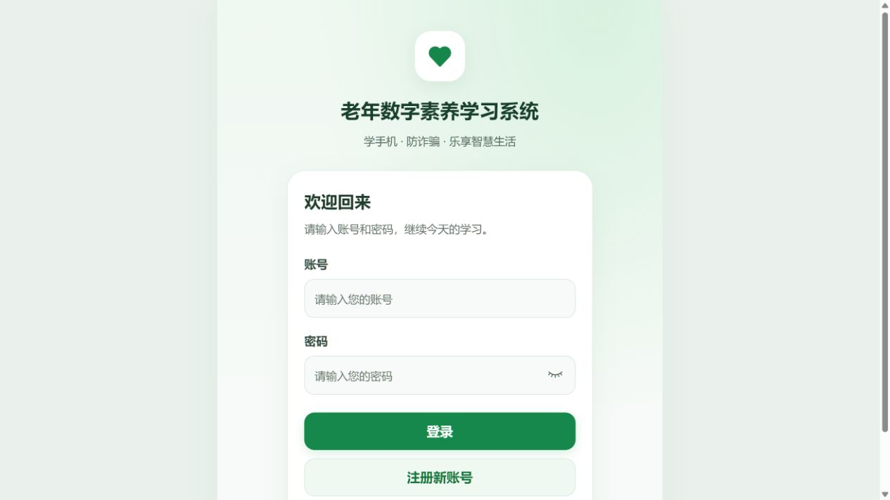
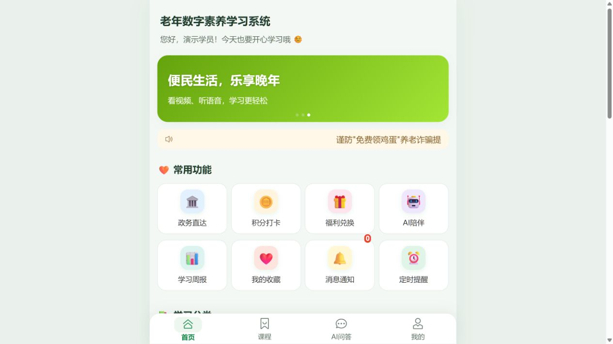
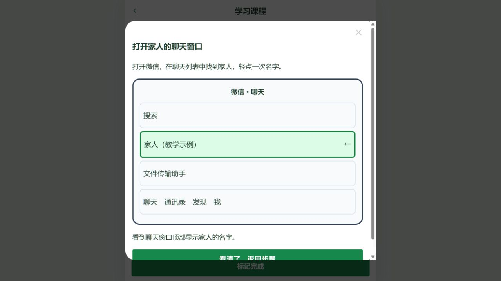
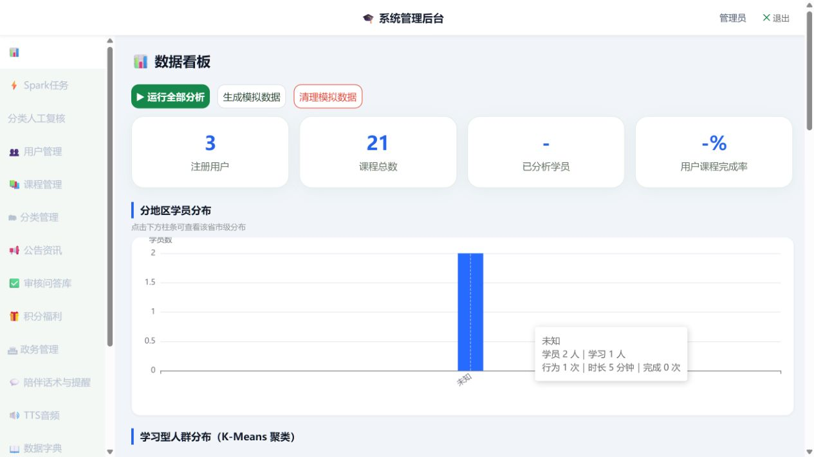
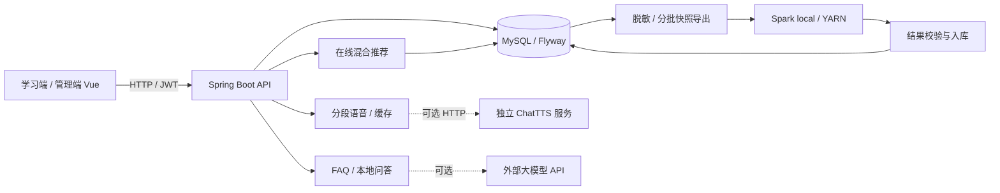

# 老年数字素养学习系统

面向老年用户的数字技能学习项目：把课程学习、适老化显示、问答、语音朗读、学习记录和课程推荐整合到移动端页面，并提供课程与学情管理后台。

**技术栈：** Vue 3 / Vite / Vant / Pinia · Java 17 / Spring Boot / Spring Security / MyBatis-Plus · MySQL 8 / Flyway · Spark。ChatTTS 和外部大模型是可选服务。

[最小启动](docs/quickstart.md) · [架构与实现](docs/architecture.md) ·   [公开准备状态](docs/release-readiness.md) · [安全说明](SECURITY.md)

## 界面预览

以下为本地真实运行界面，使用隔离数据库及演示账号，无真实用户数据。截图与视频的验证范围见 [演示说明](docs/demo-guide.md)。

| 登录 | 学习首页 |
| --- | --- |
|  |  |

| 课程步骤示意 | 管理后台 |
| --- | --- |
|  |  |

查看界面导览视频（MP4，无声）（本地验收材料，不随公开源码分发）。视频由本次真实界面截图按演示顺序编排，方便快速浏览；完整交互验收按演示文档操作。

## 值得展开的实现

| 问题 | 当前实现 | 源码与证据 |
| --- | --- | --- |
| 新用户或行为稀疏时如何推荐 | 内容候选 + ALS / ItemCF 名次融合；热门/最新补位；全历史已学过滤、过期模型过滤；真实与模拟批次隔离 | [推荐服务](backend/src/main/java/com/elderly/service/impl/HybridRecommendationService.java)、[策略与限制](docs/hybrid-course-recommendation.md) |
| 长文本朗读等待、切换后串音 | 分段生成与预取；取消旧会话；服务端缓存与预热 | [前端播放器](frontend/src/components/TtsPlayer.vue)、[相关测试](frontend/tests/ttsPlayer.test.mjs)、[语音部署](docs/tts-deployment.md) |
| 离线分析如何接入业务系统 | 独立 Spark 任务模块，支持本地 / YARN 路径；快照输入、结果解析和批次记录 | [任务入口](spark-analysis/src/main/java/com/elderly/spark/AnalysisJobMain.java)、[结果验证](docs/current-mock-spark-validation.md) |
| 外部 AI 服务不可用时如何保留问答 | 人工审核 FAQ 优先，外部模型按配置启用，失败后降级本地规则；返回来源标识 | [问答服务](backend/src/main/java/com/elderly/service/impl/AiChatServiceImpl.java) |
| 新环境如何复现并限制权限 | Flyway 版本迁移、独立应用/迁移账号、显式创建首次管理员、生产配置校验和备份脚本 | [快速启动](docs/quickstart.md)、[部署文档](docs/first-deployment.md) |

以上描述代码中已有实现，不代表真实用户业务效果、生产容量或作者个人贡献已经得到独立验证。

## 系统结构



部署边界、推荐流程和扩展限制见 [架构文档](docs/architecture.md)。

## 本地运行

需要 Java 17、Maven、Node.js 22 和 MySQL 8。先按 [最小启动](docs/quickstart.md) 创建数据库账号和私有配置，填写数据库密码与随机 JWT 密钥。示例默认关闭外部 AI 与语音预热，无需 AI Key、语音模型或 Hadoop 集群。

```powershell
mvn -B -f spark-analysis/pom.xml install
mvn -B -f backend/pom.xml spring-boot:run
```

另开终端：

```powershell
npm --prefix frontend ci
npm --prefix frontend run dev
```

打开 [http://localhost:5173](http://localhost:5173)。学习账号自行注册；管理员通过显式私有配置创建，无默认公开密码。公开源码包排除未获授权的媒体，保留课程文字及代码绘制的步骤示意图。

## 验证与效果边界

```powershell
npm --prefix frontend test
npm --prefix frontend run build
mvn -B -f backend/pom.xml verify
python -m unittest discover -s tools -p "test_*.py"
python tools/audit_git.py --source-tree
```

[GitHub Actions](.github/workflows/ci.yml) 包含前端测试与构建、Java 测试与打包、源码审计与公开包生成。工作流配置已加入；实际托管平台运行结果以 Actions 为准。

推荐评估使用模拟数据。已有报告中的 Recall@5 是指定模拟留出集结果，不能视为真实用户效果；分类置信度不等于分类准确率。数据规模、基线和未覆盖范围见 [模拟数据验证报告](docs/current-mock-spark-validation.md)。当前没有生产并发量、用户满意度或商业转化结论。

## 公开源码与许可

自有源码和文档采用 [MIT License](LICENSE)，第三方依赖、模型与媒体的范围见 [NOTICE](NOTICE.md)。维护者确认现有课程媒体没有自制记录或转载授权，默认不随公开包分发，原文件保留本地；逐文件清单见 [素材核验](docs/media-rights.md)。

```powershell
python tools/prepare_public_release.py
```

默认生成 `work/public/elderly-study-source.zip` 和 SHA-256 校验文件，仅包含源码清单；不带旧 Git 历史、私有配置、用户数据、构建缓存或待核验媒体。可将该包解压到新目录后建立独立仓库。**旧凭据是否已轮换仍待维护者确认**，干净源码包不能替代服务端轮换。完整步骤见 [发布检查](docs/git-publishing.md)。

## 其他文档

- [首次部署](docs/first-deployment.md) / [生产配置](docs/server-deployment.md) / [语音服务](docs/tts-deployment.md)
- [后端接口](docs/后端接口文档.md)
- [推荐策略](docs/hybrid-course-recommendation.md) / [文本分类置信度](docs/text-classification-confidence.md)
- [课程素材候选与核验记录](docs/course-source-review.md)
