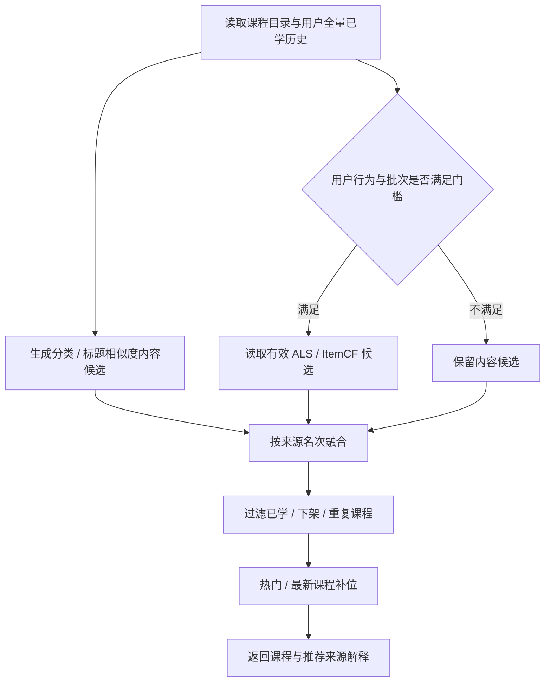

# 架构与设计取舍

## 模块边界

| 目录 | 职责 |
| --- | --- |
| `frontend` | Vue 学习端与管理端，Vant 交互、Pinia 状态、Axios 请求、分段语音播放 |
| `backend` | Spring Boot API，JWT 认证、方法级权限、业务服务、MySQL 持久化、分析编排 |
| `spark-analysis` | 独立任务模块，统计、聚类、关联规则、协同过滤与文本分类；不依赖 Web 控制器 |
| `shared` | 前后端/语音使用的课程文字资料 |
| `deploy` / `tools` | 配置模板、备份、部署包、审计与复验脚本 |
| `android-app` / `frontend/android` | 原生 WebView / Capacitor 包装路径；Web 是本次默认验证入口 |

Web 生产部署由 Nginx 提供静态页面并代理 API、上传资源；本地开发由 Vite 代理后端端口。数据库承担在线业务持久化，Spark 负责离线任务；没有引入独立消息队列或在线特征服务。

## 推荐链路

融合使用名次以避免不同算法原始分数的量纲影响。门槛和权重是初始规则，尚未通过真实用户实验调优。请求中读取课程并计算内容关联，适合当前小课程库；规模扩大时需预计算特征、缓存公共统计，并保留实时历史排除。不能从当前实现推导大规模 QPS。

## 分析链路

`SparkCsvExporter` 导出一次任务的输入快照；`TaskRunner` 按配置执行本地或 YARN 路径，读取和校验结果后更新分析表与批次元数据。线上推荐依据来源、完成状态、快照与时效过滤候选，模拟结果不直接混入真实用户推荐。

Spark 模块按 Java 8 字节码和 Spark 3.2 API 编译，本地后端使用 Spark 3.5.1。当前测试不代表所有目标集群版本均已验收；YARN 的实际权限、资源调度、连接和运维仍需目标环境验证。

## 语音与问答

语音由后端分段请求独立 HTTP 服务、缓存结果，前端尽早播放首段并预取后续段。取消和切换会话时丢弃旧结果，测试覆盖串音与延迟响应。关闭预热可以启动核心业务，但不提供离线合成能力。

问答优先命中审核 FAQ，其次是配置启用且有可用密钥的模型，最后降级到关键词规则；页面显示实际回答来源。规则内容是项目演示资料，政务流程的地区、版本和有效性仍需单独核验。

## 认证与复现

API 使用无状态 JWT，密码使用 BCrypt。后端控制接口权限；前端路由守卫用于导航体验。生产配置检查随机 JWT 密钥、非 root 业务账号、独立迁移账号和明确路径。管理员首次创建需显式启用，没有默认管理员密码。

Flyway 空库迁移和已有 V1 基线升级由独立 MySQL 测试覆盖。历史迁移包含固定库名，本版本使用 `elderly_study`；不能仅修改 JDBC URL 改名。备份脚本的自动测试使用伪造 dump 命令验证归档行为，不能替代真实备份恢复演练。
